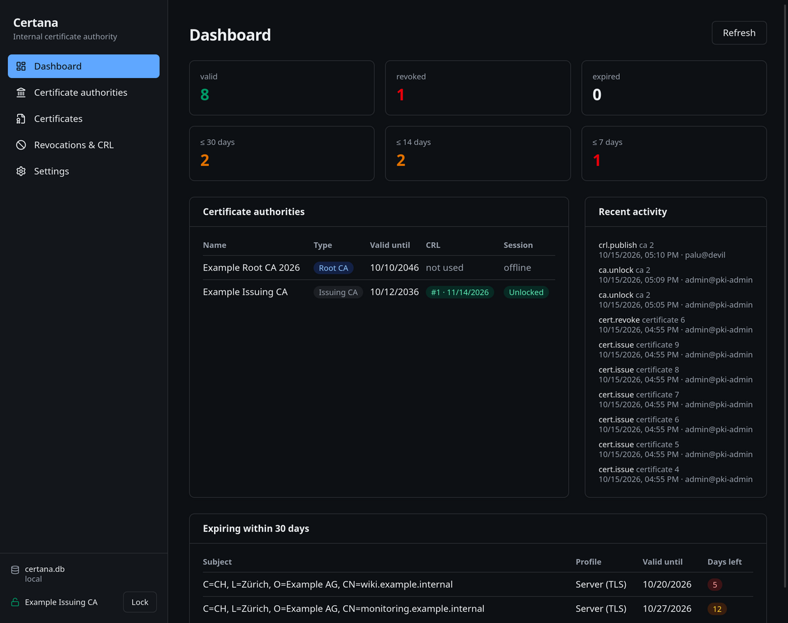
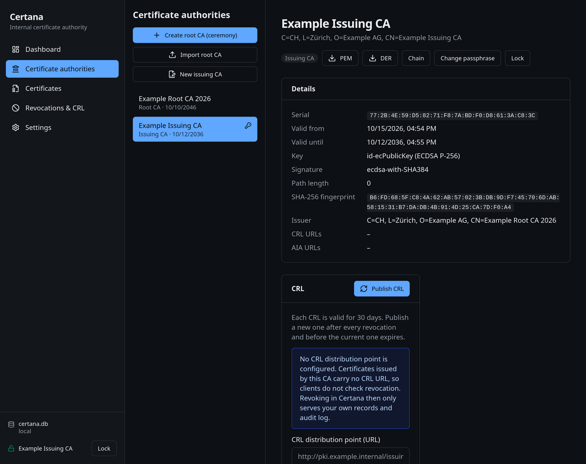
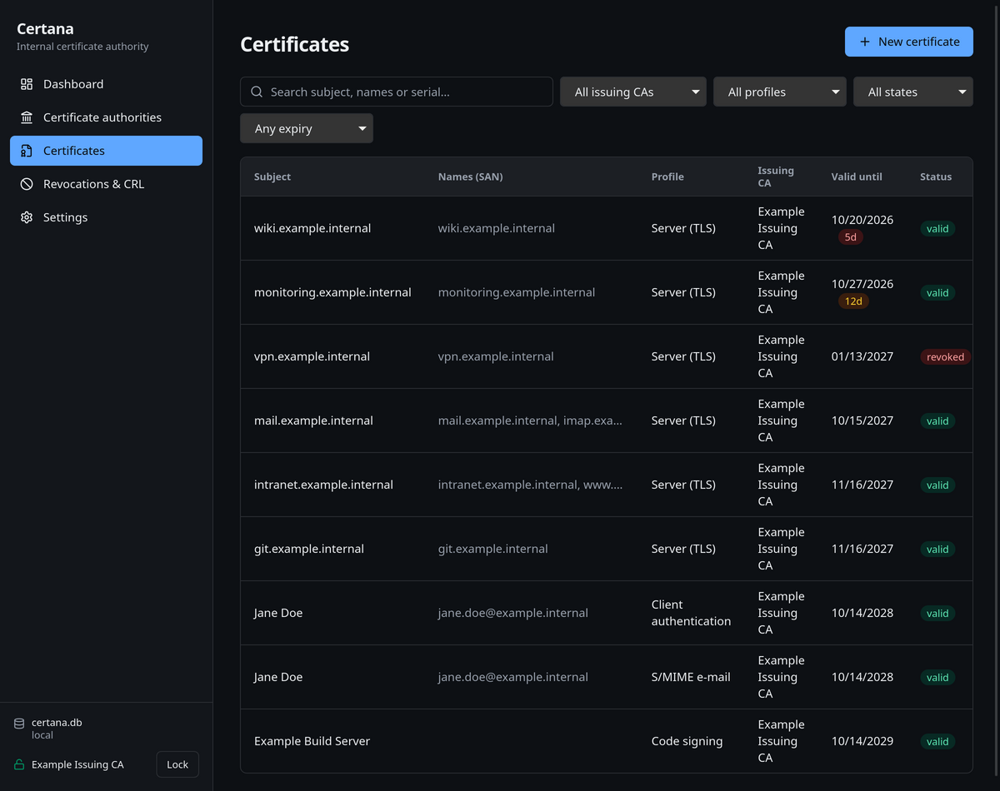
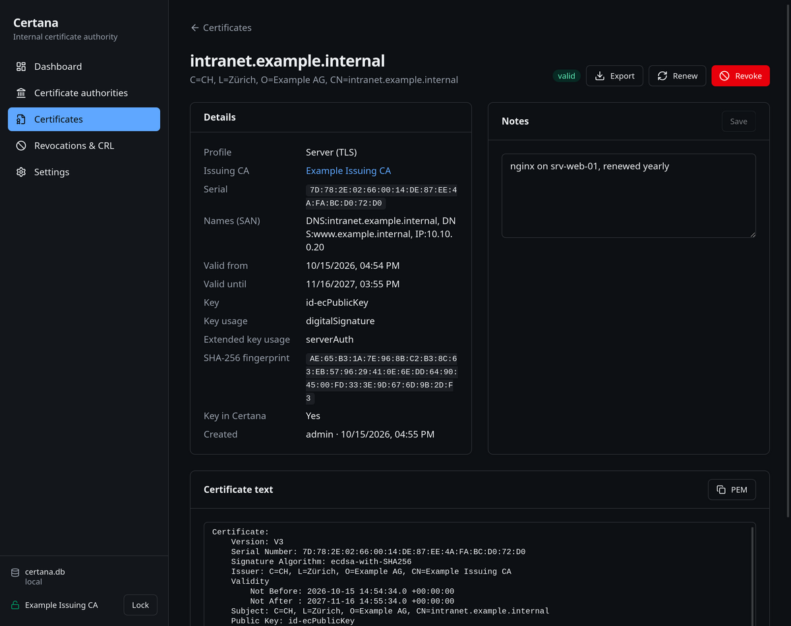
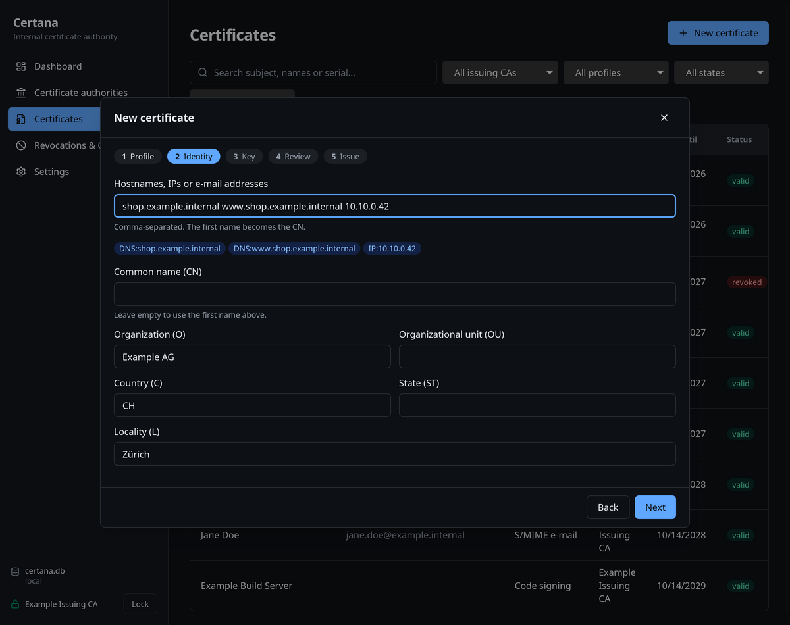
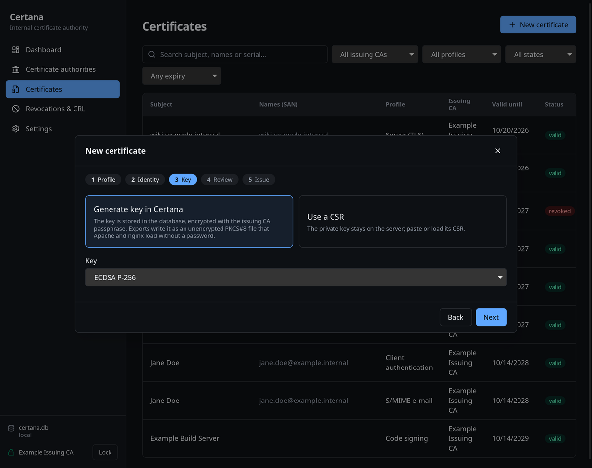

# Certana

**Certana** is a native desktop application for running your own internal Certificate Authority
(Linux first, Windows installer included, macOS builds from source):
create an offline root CA (or import one), operate an intermediate CA, issue server certificates for
Apache/nginx as well as client, S/MIME and code-signing certificates, manage renewals, revoke and
publish CRLs, and keep an eye on expiry dates.

- Built with Rust + Tauri 2, React and SQLite – ships as a small native binary (`.deb` ≈ 4.5 MiB, AppImage, `.rpm`, Windows `.exe` installer).
- Private keys never leave the Rust process; the root key is stored only in an encrypted offline bundle, never in the database.
- Pure-Rust cryptography (rcgen, pkcs8, p12-keystore) – no OpenSSL dependency, but every file stays OpenSSL-compatible
  (`openssl verify`, `x509`, `pkey`, `pkcs12`, `crl` are part of the test suite).
- Issuing CA keys are encrypted with a passphrase and unlocked per session with automatic idle lock; every action is audited.
- Works with or without a CRL distribution point – for a purely internal CA you can simply leave it empty.
- UI in English and German, light and dark theme.

## Screenshots

| Dashboard | Issuing CA |
|---|---|
|  |  |

| Certificates | Certificate detail |
|---|---|
|  |  |

| Wizard – identity | Wizard – key |
|---|---|
|  |  |

## Installation

Download the package for your distribution from the [Releases](https://github.com/Khithar/certana/releases) page.

```sh
# Debian / Ubuntu / Linux Mint
sudo apt install ./Certana_1.0.1_amd64.deb      # pulls in libwebkit2gtk-4.1-0 and libgtk-3-0

# Fedora / RHEL
sudo dnf install ./Certana-1.0.1-1.x86_64.rpm

# Any distribution
chmod +x Certana_1.0.1_amd64.AppImage && ./Certana_1.0.1_amd64.AppImage
```

**Windows:** run `Certana_1.0.1_x64-setup.exe` (needs the WebView2 runtime, which the installer fetches if
missing). The Windows build is produced by CI and has not been through the same manual testing as the Linux
packages yet. Note that exported private keys are written with restrictive `0600` permissions on Linux only; on
Windows they inherit the permissions of the target folder.

Certana appears in the start menu under *Utilities*. Data is stored in `~/.local/share/certana/certana.db` on
Linux and `%APPDATA%\certana\certana.db` on Windows (configurable; a database on a network share switches to a
shared mode with a writer lock).

## Quick start

1. **Create a root CA (ceremony)** – ideally offline. The root key is written only to an encrypted `*.certana-root`
   bundle (keep it on a USB stick); the database stores just the certificate.
2. **Create an issuing CA** – signed with the root bundle, its key is stored encrypted in the database and protected by
   a passphrase you enter to unlock it for a session.
3. **Issue certificates** via the wizard (server for Apache/nginx, client, S/MIME, code signing) – either let Certana
   generate the key or paste a CSR from the server.
4. **Export** – PEM certificate, chain and full chain, optionally DER, the unencrypted PKCS#8 key (0600) and PKCS#12,
   together with ready-to-paste nginx/Apache snippets.
5. **Distribute the root certificate** – the CA page shows the commands for Debian/Ubuntu, RHEL, Windows, macOS,
   Firefox and Java.

Renewal, revocation, CRL publication, expiry warnings and the audit log live in the respective pages.

## Building from source

Linux Mint 22 / Ubuntu 24.04 (Windows: install Rust, Node 22 and the Visual Studio C++ build tools, then run
the same `npm` commands; `npm run tauri build -- --bundles nsis` produces the installer):

```sh
sudo apt install libwebkit2gtk-4.1-dev build-essential curl wget file libxdo-dev \
  libssl-dev libayatana-appindicator3-dev librsvg2-dev patchelf
curl --proto '=https' --tlsv1.2 -sSf https://sh.rustup.rs | sh     # Rust >= 1.90
npm install
npm run tauri dev        # development
npm run tauri build      # .deb / AppImage / .rpm in src-tauri/target/release/bundle/ (no version bump)
```

### Releasing

Every release build bumps the version first so that `apt` recognises the new package:

```sh
npm run release          # bump patch version, then build all bundles
npm run release:deb      # bump patch version, then build only the .deb
npm run bump -- minor    # bump only: patch | minor | major
```

The version lives in `package.json`, `src-tauri/tauri.conf.json` and `src-tauri/Cargo.toml`;
`scripts/bump-version.mjs` keeps all three in sync and updates `Cargo.lock`.

## Tests

```sh
cargo test --manifest-path src-tauri/Cargo.toml --workspace   # core PKI, OpenSSL interop, DB flow, command flow
npm run lint && npm run typecheck
```

## Documentation

Project documentation lives in the Obsidian vault under `docs/vault/` (German).

## License

GPL-3.0-or-later – see [LICENSE](LICENSE).
